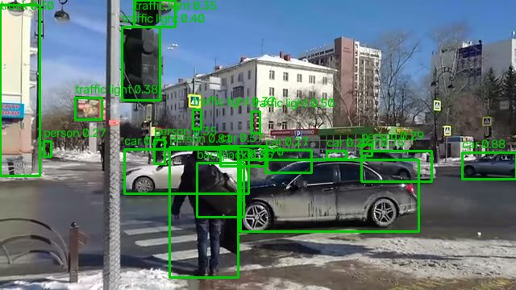

# Детекция объектов на видео

Фреймворк: **PyTorch Hub**. Модель: [`yolov5s`](https://github.com/ultralytics/yolov5) из репозитория `ultralytics/yolov5`, обучена на COCO.

## Техническое задание

- **Цель:** найти на видео людей, машины и другие объекты из 80 классов COCO и обвести их рамками.
- **Вход:** видеофайл (mp4, avi и другие форматы, которые читает OpenCV) или отдельный кадр как массив BGR.
- **Выход:** видео с нарисованными рамками, подписью класса и уверенностью. Для каждого кадра есть список объектов: класс, уверенность и координаты рамки в пикселях. Сводка показывает, сколько объектов каждого класса в среднем и максимум на кадре.
- **Ограничения:** работа на CPU без видеокарты. Реального времени на таком процессоре не будет, поэтому цель такая: обрабатывать не меньше 5 кадров/с. Есть режим, в котором модель запускается только на каждом N-м кадре.
- **Критерии качества:** у самой модели mAP на COCO по документации, своей разметки у видео нет. На роликах проверяем глазами, что люди и машины находятся, и меряем скорость.

## Установка

Нужен доступ в интернет при первом запуске: `torch.hub` скачивает код YOLOv5 с GitHub и веса (~14 МБ) в `~/.cache/torch/hub`.

```bash
python3.12 -m venv .venv
source .venv/bin/activate
pip install -r requirements.txt
```

PyTorch ставится в версии только для CPU, она весит намного меньше сборки с CUDA. Код YOLOv5 берётся из ветки `master`, и если нужных ему пакетов нет, он доставляет их сам через pip. Чтобы этого не было, все они перечислены в `requirements.txt`.

## Запуск

```bash
python detect.py examples/crossroad.mp4                  # результат в outputs/crossroad_detected.mp4
python detect.py examples/crossroad.mp4 --every 3 -o out.mp4
```

Из кода:

```python
import cv2
from detect import detect
detect(cv2.imread("examples/crossroad.jpg"))
# [{'label': 'car', 'score': 0.899, 'box': [298, 198, 519, 287]}, ...]
```

## Пример

В `examples/crossroad.mp4` лежат 5 секунд ролика с перекрёстком в Тюмени, 640×360. Один кадр из него с рамками:



На этом кадре модель нашла 18 объектов: машины, людей, светофоры, сумку. Близкие объекты получают уверенность 0.8–0.9. Дальние светофоры и люди у края кадра находятся с уверенностью 0.3–0.4, и часть из них ложные.

## Оценка качества

Ролики для оценки лежат в `data/` (в репозиторий не входят). Скачать их и перевести в 720p:

```bash
mkdir -p data && cd data
C=https://upload.wikimedia.org/wikipedia/commons
curl -L -o crossroad.webm "$C/8/8f/Kruci%C4%9Do_de_stratoj_Respubliko_kaj_Or%C4%9Donikidze_%28Tjumeno%29.webm"
curl -L -o crosswalk.webm "$C/f/f0/Piedirejo_en_strato_Herzen_%28Tjumeno%29.webm"
curl -L -o bangkok.webm "$C/a/a9/Bangkok_Traffic_During_Enduring_Partners_26_%281009429%29.webm"
for v in crossroad crosswalk bangkok; do
  ffmpeg -i $v.webm -t 20 -vf scale=-2:720 -an -c:v libx264 -crf 23 $v.mp4
done
curl -L -O https://github.com/intel-iot-devkit/sample-videos/raw/master/car-detection.mp4
cd ..
```

| Файл | Что в кадре | Автор, источник, лицензия |
|------|-------------|---------------------------|
| `crossroad.mp4` | перекрёсток в Тюмени зимой, пешеходы и машины | RG72, [Wikimedia Commons](https://commons.wikimedia.org/wiki/File:Kruci%C4%9Do_de_stratoj_Respubliko_kaj_Or%C4%9Donikidze_(Tjumeno).webm), CC BY-SA 4.0 |
| `crosswalk.mp4` | пешеходный переход на ул. Герцена в Тюмени | RG72, [Wikimedia Commons](https://commons.wikimedia.org/wiki/File:Piedirejo_en_strato_Herzen_(Tjumeno).webm), CC BY-SA 4.0 |
| `bangkok.mp4` | улица в Бангкоке: машины и микроавтобусы крупным планом, в конце тротуар и уличное кафе | Staff Sgt. James Bunn, U.S. Army National Guard, [Wikimedia Commons](https://commons.wikimedia.org/wiki/File:Bangkok_Traffic_During_Enduring_Partners_26_(1009429).webm), public domain |
| `car-detection.mp4` | парковка, съёмка сверху | Intel, [intel-iot-devkit/sample-videos](https://github.com/intel-iot-devkit/sample-videos), CC BY 4.0 |

Ролики из Commons обрезаны до 20 секунд и уменьшены до 720p, звук убран.

```bash
python evaluate.py
python evaluate.py --videos crossroad.mp4 --every 2 5
```

Своей разметки у роликов нет, поэтому mAP посчитать на них нельзя. Ниже точность модели на COCO val2017 из [документации YOLOv5](https://github.com/ultralytics/yolov5#pretrained-checkpoints), вход 640 px:

| Модель | Параметров | mAP@0.5:0.95 | mAP@0.5 |
|--------|-----------:|-------------:|--------:|
| yolov5n | 1.9 M | 28.0 | 45.7 |
| **yolov5s** | 7.2 M | 37.4 | 56.8 |
| yolov5m | 21.2 M | 45.4 | 64.1 |

- **mAP@0.5** — средняя по классам площадь под кривой precision-recall. Рамка считается найденной, если она перекрывается с правильной хотя бы наполовину (IoU ≥ 0.5).
- **mAP@0.5:0.95** — то же, но усреднённое по порогам IoU от 0.5 до 0.95. Эта метрика строже и учитывает, насколько точно рамка лежит на объекте.

Что модель находит на роликах, в среднем и максимум объектов на кадре:

| Видео | person | car | traffic light | truck | Прочее |
|-------|-------:|----:|--------------:|------:|--------|
| crossroad | 8.1 / 17 | 7.2 / 13 | 4.3 / 8 | 0.2 / 2 | handbag 1.1, backpack 0.4 |
| crosswalk | 8.5 / 16 | 8.5 / 14 | 4.1 / 7 | 0.1 / 2 | handbag 0.4, bicycle 0.1 |
| bangkok | 2.4 / 10 | 4.1 / 14 | 0.3 / 3 | 1.4 / 5 | chair 1.1, motorcycle 1.1 |
| car-detection | 0.0 / 1 | 0.2 / 2 | | | cell phone 0.3 |

Трекинга нет, поэтому один человек на 100 кадрах даёт 100 детекций. Сколько всего разных людей прошло через кадр, так не посчитать.

Скорость обработки (кадров/с) и F1 совпадения рамок с режимом «модель на каждом кадре». Во втором режиме модель запускается на каждом N-м кадре, а на остальных остаются рамки с последнего обработанного:

| Видео | N=1 | N=2 | N=3 | N=5 |
|-------|----:|----:|----:|----:|
| crossroad | 9.1 / 1.00 | 18.1 / 0.95 | 26.7 / 0.92 | 38.5 / 0.87 |
| crosswalk | 8.9 / 1.00 | 14.8 / 0.95 | 21.7 / 0.93 | 36.2 / 0.89 |
| bangkok | 7.6 / 1.00 | 14.4 / 0.96 | 20.5 / 0.93 | 33.5 / 0.89 |
| car-detection | 7.7 / 1.00 | 15.1 / 0.91 | 22.7 / 0.85 | 33.9 / 0.74 |

Рамки совпадают, если у них один класс и IoU ≥ 0.5. Скорость включает чтение кадра из файла, без записи выходного видео. Замеры на CPU Intel i3-7100, загрузка модели не учитывается. Между запусками скорость отличается на 10–15%.

На каждом кадре YOLOv5s выдаёт 8–9 кадров/с, это около 110–130 мс на кадр, а в документации на CPU указано 98 мс. Уличное видео идёт с частотой 30 кадров/с, так что в реальном времени модель на этом процессоре не успевает. При N=3 скорость выходит 20–27 кадров/с, а рамки совпадают с полной обработкой на 92–93%: машины и люди за десятую долю секунды почти не сдвигаются. При N=5 совпадение падает до 0.87–0.89, на быстро движущихся объектах рамки заметно отстают.

На уличных роликах модель уверенно находит людей, машины и светофоры, даже мелкие и вдалеке. Ошибки в основном на дальних объектах с уверенностью 0.3–0.4. Микроавтобусы в Бангкоке она называет то `car`, то `truck`: отдельного класса для них в COCO нет. А «стулья» там настоящие: в конце ролик заходит в уличное кафе.

Ролик `car-detection` снят сверху, и здесь модель ошибается сильно. Машину она видит и рамку ставит правильно, но класс путает: сверху машина похожа на прямоугольник, и модель называет её `cell phone` с уверенностью 0.6–0.7. Одну красную машину она уверенно (0.73) приняла за человека. Снимков сверху в COCO почти нет, так что для такой камеры модель надо дообучать на своих кадрах.
